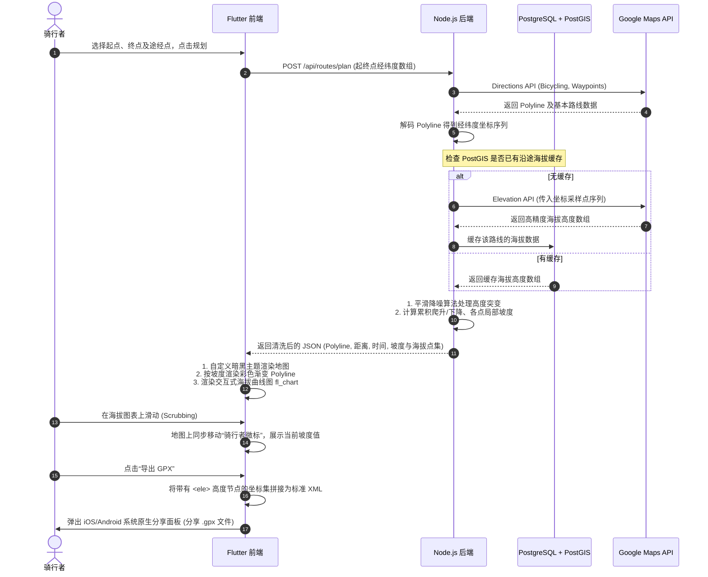

# **VeloRoam 骑行路线规划 App - 核心功能 PRD (精炼高级版)**

### **一、 产品概述与设计愿景**

* **产品目标：** 为骑行爱好者提供一款轻量、极速且具备极致视觉冲击力的路线规划工具。利用 Google Maps 强大的底层数据生成优质骑行路线，集成高精度海拔剖面与坡度分析，打通主流硬件生态（导出含高度数据的 GPX 文件），并提供无缝的导航外呼体验。
* **目标用户：** 对路线坡度敏感的爬坡爱好者、公路车手、拥有独立码表（Garmin/Wahoo 等）的极客骑行者。
* **设计调性：** 赛博朋克深色美学（Cyberpunk Dark Aesthetic）。以深色基调地图为底，发光渐变轨迹（代表坡度）为主视觉，结合高响应度的玻璃微光（Glassmorphism）交互面板。

---

### **二、 技术架构与选型 (技术基底)**

| 模块 | 技术选型 | 核心作用与考量 |
| --- | --- | --- |
| **移动端 (前端)** | **Flutter (Dart)** | 构建 iOS & Android 双端。使用 `google_maps_flutter` 实现底图展示与高级自定义样式；使用 `fl_chart` 绘制高性能交互式海拔图表；使用 `url_launcher` 与 `share_plus` 处理外呼及系统分享。 |
| **服务端 (后端)** | **Node.js (TypeScript) + Express/NestJS** | 提供 RESTful API 接口。集中请求 Google Maps & Elevation API，隐藏私密 API Key；处理海拔数据平滑降噪算法，拼接干净的路线包返回。 |
| **数据库** | **PostgreSQL + PostGIS** | MVP 阶段存储路线元数据及常见骑行路线的海拔点本地缓存，避免重复请求 Elevation API，大幅降低 Google Cloud 计费成本。 |
| **核心服务** | **Google Maps Platform** | 1. **Maps SDK**: 移动端底图渲染与自定义 JSON 主题配置。<br>2. **Directions API**: 后端调用，生成骑行（`mode=bicycling`）路线数据及 Polyline 编码。<br>3. **Elevation API**: 后端调用，获取路线轨迹采样点的海拔高度。 |
| **部署与运维** | **Docker + Cloud Host** | 容器化部署后端与数据库，保障一键迁移与弹性部署能力。 |

---

### **三、 核心功能矩阵**

| 功能模块 | 功能名称 | 描述 | 优先级 |
| --- | --- | --- | --- |
| **地图与规划** | 起终点与多途经点搜索 | 支持起点、终点以及多个途经点（Waypoints）的检索与拖拽重排，支持地图长按插针选点。 | P0 |
| **地图与规划** | 自适应骑行路线生成 | 请求最适合自行车的骑行路线，在地图上绘制并自适应缩放视野。 | P0 |
| **视觉与交互** | 赛博暗黑主题地图 | 采用定制化的极简暗色 Google Map，剔除嘈杂信息，突出彩色路线轨迹。 | P0 |
| **海拔与坡度** | 交互式海拔高度图 | 在底部面板展示高精度渐变高度曲线，支持滑动 Scrubbing。滑动时，地图上同步显示对应的“当前骑手位置坐标”，并提供震动反馈。 | P0 |
| **海拔与坡度** | 坡度彩色发光轨迹 | 路线 Polyline 根据局部坡度呈现不同颜色（平路绿色、缓坡黄色、陡坡发光红），方便提前预知前方地形。 | P1 |
| **数据流转** | 一键外呼原生导航 | 一键拉起本地 Google Maps 并自动带入起终点及途经点，进入自行车骑行导航模式。 | P0 |
| **数据流转** | 包含海拔的 GPX 导出 | 导出符合 Garmin/Wahoo 规范的标准 GPX 文件（内含 `<ele>` 海拔节点），支持调用系统原生分享面板。 | P0 |

---

### **四、 核心系统数据流与交互**



---

### **五、 核心功能详细技术规范**

#### **5.1 赛博暗黑主题地图与坡度轨迹绘制**
* **地图视觉：** 隐藏商铺、行政区等干扰信息。道路呈现为深灰色（`#212121`），水体为深邃蓝（`#0D47A1`），陆地为暗黑（`#121212`）。
* **技术实现：** 
  * 前端加载包含上述风格的 JSON 配置项并应用到 `GoogleMapController.setMapStyle(styleString)`。
  * 根据后端返回的路线点数组中每个点的局部坡度（Slope），将 Polyline 分割为多个不同颜色的小段（Segments），在地图上拼接绘制。
  * **坡度显色规范：**
    * 坡度 $\le 1\%$：极光绿 (`#00E676`)
    * $1\% < 坡度 \le 5\%$：明黄色 (`#FFD600`)
    * $5\% < 坡度 \le 10\%$：香橙色 (`#FF9100`)
    * 坡度 $> 10\%$：烈焰红 (`#FF1744`)

#### **5.2 交互式海拔高度图 (Elevation scrubbing)**
* **交互体验：** 底部卡片滑出，以曲线填充图展示（X轴为累积里程，Y轴为海拔高度）。当用户手指划过曲线时，图表上出现垂直指示线，同时地图上的路线轨迹上产生一个发光的“虚拟骑手”图标，随手指移动同步移动。
* **数据算法 (后端处理)：**
  * 设 Google Elevation API 返回的海拔采样序列为 $H_1, H_2, \dots, H_n$，对应的采样点距离序列为 $D_1, D_2, \dots, D_n$。
  * **降噪滤波：** 为避免 GPS 漂移导致的高度剧烈跳动，后端采用简单的滑动平均滤波（Moving Average Filter）对海拔数据进行平滑处理。
  * **坡度计算公式：** 两点之间的坡度计算为：
    $$Slope_i = \frac{H_i - H_{i-1}}{D_i - D_{i-1}} \times 100\%$$

#### **5.3 包含高程数据的 GPX 导出**
* **重要性：** 纯经纬度 GPX 导入 Garmin 或 Wahoo 码表时，码表无法显示海拔剖面或爬坡预警（ClimbPro）。必须在 `<trkpt>` 节点中内嵌 `<ele>`。
* **格式规范：**
  ```xml
  <?xml version="1.0" encoding="UTF-8"?>
  <gpx version="1.1" creator="VeloRoam" xmlns="http://www.topografix.com/GPX/1/1">
    <metadata>
      <name>VeloRoam 优质骑行路线</name>
      <desc>总里程: 45.2km | 累计爬升: 620m</desc>
    </metadata>
    <trk>
      <name>环莫干山越野线路</name>
      <trkseg>
        <trkpt lat="30.596238" lon="119.854378">
          <ele>248.5</ele>
        </trkpt>
        <trkpt lat="30.596541" lon="119.855012">
          <ele>251.2</ele>
        </trkpt>
      </trkseg>
    </trk>
  </gpx>
  ```
* **技术实现：** 
  * 前端利用 `path_provider` 创建名为 `veloroam_route.gpx` 的临时文件，写入 XML 文本。
  * 使用 `share_plus.Share.shareXFiles` 发起原生系统分享，支持直接投递至 Garmin Connect App、WeChat、AirDrop 等。

---

### **六、 独立开发约束与风险管理**

* **API 资费控制 (熔断器)：**
  * 限制单次规划的最大采样点数为 **100 个**，避免一次请求消耗过多 Elevation API 配额。
  * 数据库 PostGIS 缓存：相同的起终点与途经点组合，后端应优先匹配数据库缓存，缓存命中则直接返回，防刷防过载。
* **错误退化（Graceful Degradation）：**
  * 若 Google Elevation API 超出限额或请求失败，后端需正常返回路线经纬度，并附加 `elevation_available: false`。前端退化为仅绘制普通 Polyline（不显示高度图），并向用户友好提示“当前海拔数据不可用，但不影响路线生成”。